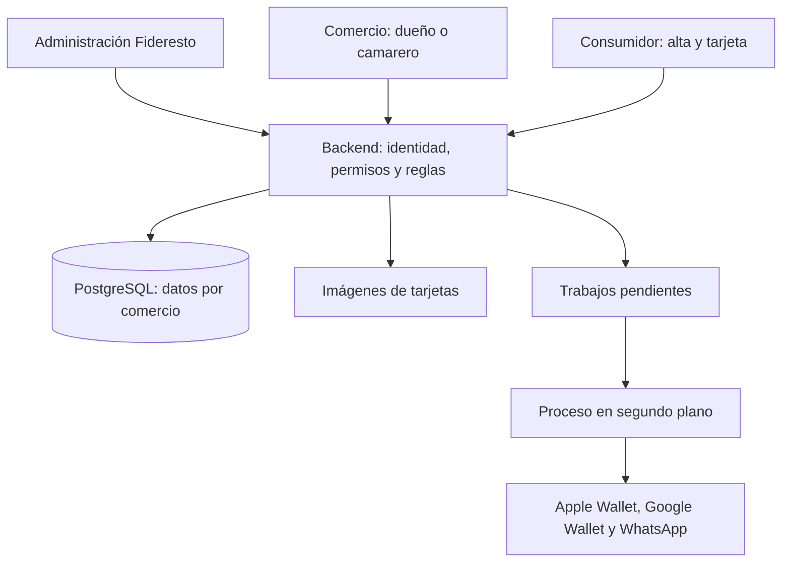

# Arquitectura y entornos

Propuesta v0.1 · 30 de octubre de 2026. Evaluación de la propuesta de Víctor, con contraste de NFC en documentación oficial. Sin aplicación implementada; stack y alojamiento recomendados no elegidos todavía. Nexo aporta método de cerebro/seguridad, no infraestructura ni stack heredados.

## Base planteada por Víctor

Aplicación web de uso principalmente móvil, con dos áreas de acceso profesional:

- Administración de Fideresto: Víctor y su equipo operan la plataforma.
- Comercio que contrata: dueño administra su cuenta, programa, WhatsApp, NFC y autorizaciones; camarero/dependiente tiene acceso operativo limitado.

Cada persona accede con su identidad, desde dispositivo del negocio o propio. El consumidor tiene un recorrido de registro y tarjeta separado del acceso profesional. Esto no requiere que instale una app propia de Fideresto.

Aclaraciones confirmadas en este turno: la afiliación se activa al verificar el móvil, sin aprobación manual de altas. El camarero también registra canjes. Se mantiene la solicitud de corrección con mensaje de motivo y autorización del dueño/encargado; un rol adicional de encargado sigue siendo una ampliación por decidir.

## Recomendación técnica, pendiente de elección

Una web adaptable e instalable como PWA, un backend modular y una base de datos transaccional. Una base de código y despliegue inicial sencillo; separar responsabilidades dentro del código. Los trabajos de WhatsApp y Wallet se procesan con reintentos y límites en segundo plano, en un proceso del mismo proyecto. No necesitan bloquear el botón de confirmar sello.

Stack candidato: TypeScript con React/Next.js para interfaz y servidor, PostgreSQL para datos y almacenamiento de objetos para imágenes. No se instala ni contrata nada en este turno. Alojamiento, proveedores, versiones, presupuesto y método de autenticación se elegirán antes de implementar. Next.js permite alojamiento propio; no implica contratar un proveedor concreto.

La PWA no añade APIs NFC que el navegador no soporte. Operaciones de sellos/canjes confirmadas por servidor con conexión; funcionamiento sin conexión es ajeno a la propuesta inicial.

## Permisos iniciales

| Acción | Administración Fideresto | Dueño del comercio | Camarero/dependiente |
| --- | --- | --- | --- |
| Gestionar comercios y acceso a la plataforma | Sí, por permisos internos; propuesta | Solo su cuenta comercial | No |
| Configurar programa, premio en texto libre, mínimos y caducidad | Soporte limitado y trazable; propuesta | Sí | No |
| Configurar WhatsApp, etiquetas NFC y equipo | Soporte limitado y trazable; propuesta | Sí | No |
| Confirmar sello y registrar canje | Sin acceso operativo global por defecto; propuesta | Sí | Sí |
| Solicitar corrección con motivo | Solo si se habilita una función de soporte específica | Sí | Sí, ya confirmado |
| Autorizar correcciones | No por defecto; propuesta | Sí | No |
| Aprobar nuevas altas | No se requiere: activación tras verificar móvil | No se requiere | No se requiere |
| Consultar/exportar contactos, crear campañas | Acceso de soporte acotado; propuesta | Sí, dentro de su comercio | No por defecto |
| Agenda de reservas | Soporte acotado; propuesta | Sí | Pendiente: la restricción operativa nueva no confirma permiso de agenda |

Paneles y menús distintos simplifican el trabajo; el servidor comprueba identidad, pertenencia y permiso en cada operación. El dueño también puede realizar operaciones del camarero. Los permisos internos del equipo Fideresto se concretarán; pertenecer al equipo no equivale a ver o modificar indiscriminadamente los datos de todos los negocios.

## Datos y consistencia

Entidades propuestas: comercios, usuarios profesionales y pertenencias/roles, afiliaciones de consumidores al comercio, programa y versiones, etiquetas NFC, movimientos de sellos, premios obtenidos, canjes, solicitudes de corrección, preferencias de comunicación, agenda y trabajos de integración.

Todo dato del negocio lleva ámbito de comercio; no se crea una tarjeta ni perfil comercial universal que mezcle datos entre locales. Elegir un modelo mínimo de identidad telefónica sin exponer afiliaciones de otros negocios. Conservar texto del premio obtenido y registro de movimientos; un cambio de temporada no altera un premio ganado.

Sello y canje se registran transaccionalmente con clave de operación para evitar duplicados por doble clic/reintento. El saldo en Wallet refleja al servidor; el contenido mostrado por el cliente no autoriza operaciones. Confirmar el movimiento puede completarse antes de actualizar Wallet; los fallos de actualización quedan pendientes para reintento visible.

## NFC: tres funciones diferentes

1. **Configurar una etiqueta física.** Escribir una URL HTTPS en un chip NDEF compatible y escribible.
2. **Leer la etiqueta del local.** El consumidor acerca su móvil y abre el enlace, sujeto a compatibilidad del dispositivo. El QR impreso ofrece el mismo acceso.
3. **Leer directamente una tarjeta Wallet mediante NFC.** Es otra integración: no se deduce de que dos móviles tengan NFC. Web NFC no admite comunicación entre móviles ni emulación de tarjeta. Apple Wallet NFC y Google Smart Tap tienen requisitos propios de terminales/protocolos.

### Compatibilidad contrastada

| Operación | Android con Chrome compatible y NFC | iPhone compatible |
| --- | --- | --- |
| Abrir enlace de etiqueta NFC | Viable, probar modelos reales | Lectura en segundo plano documentada desde iPhone XS; condiciones del sistema aplican |
| Escribir etiqueta desde nuestra web | Web NFC permite NDEF; HTTPS, permiso y acción del usuario | Safari/WebKit no implementa Web NFC |
| Escribir etiqueta con app nativa compatible | Viable según app/chip | Core NFC permite escribir etiquetas NDEF escribibles |
| Leer Wallet por acercar dos móviles desde nuestra web | No lo habilita Web NFC | No lo habilita Safari |

No se ha probado hardware real todavía. No prometer compatibilidad por detectar únicamente una API ni bloquear chips de forma permanente sin una decisión explícita.

### Propuesta de instalación y mantenimiento

Grabar una dirección estable por etiqueta, sin teléfonos, claves ni credenciales dentro del chip. Nuestro equipo puede entregarla grabada como parte de la instalación asistida; el dueño podrá vincular, nombrar, comprobar, desactivar o sustituir etiquetas desde su panel. En Android compatible se puede ofrecer grabación web; en iPhone, instrucciones para una app de escritura o asistencia de nuestro equipo. No se propone desarrollar una app nativa propia solo para esta tarea inicial.

El dueño cambia programa, texto del premio o imagen en servidor; no necesita regrabar el chip. Una etiqueta desactivada deja de habilitar su recorrido en Fideresto. Una URL estática puede copiarse: no prueba presencia física ni autoriza un sello.

### Uso diario propuesto, pendiente de validar

NFC/QR del local abre la página del comercio. Si es nuevo, el consumidor se registra y verifica su móvil; si ya está identificado, accede a su tarjeta. Para sumar, puede solicitar un sello desde esa página y el camarero lo confirma al comprobar la cuenta pagada y el mínimo configurado. La lectura del chip por sí sola no suma sellos. Diseñar controles de solicitudes repetidas y clientes con el mismo nombre, sin exponer el directorio al público.

Como alternativa de operación, el camarero puede leer el QR personal de la tarjeta Wallet y confirmar el sello/canje. Esa opción no es lectura NFC de Wallet. Elegir y probar el recorrido cotidiano antes de prometer una interacción por acercar móviles; ambos Wallet, NFC y QR siguen siendo obligatorios en el piloto.

## Seguridad y entornos propuestos

- Permisos del servidor por comercio y acción. Comprobar con dos negocios que no cruzan datos, etiquetas ni trabajos de integración.
- Refuerzo de autenticación para administración y dueño; sesiones revocables. Métodos concretos pendientes. Soporte con acceso limitado, temporal y trazable.
- PostgreSQL con rol de ejecución sin superusuario ni permisos de migración. Evaluar políticas de filas como defensa adicional; no sustituyen autorización ni pruebas. Dueños de tabla y roles con BYPASSRLS pueden eludirlas; diseñar roles y contexto de comercio por transacción.
- Claves de Wallet/WhatsApp solo en servidor. Verificar autenticidad de notificaciones entrantes, aislar conexiones por negocio, acotar colas, reintentos y gasto.
- Imágenes y texto libre como entradas no confiables, con límites y presentación segura.
- Desarrollo, pruebas y producción separados; datos ficticios y recursos independientes. Copias y restauración ensayadas antes del piloto.

Consultar [[Seguridad desde el inicio]]. Todos estos controles están documentados, no implementados ni probados por esta nota.

## Fuentes contrastadas

Consultadas el 30/10/2026; revisar al implementar y probar en dispositivos reales.

- [Chrome: Web NFC, límites y permisos](https://developer.chrome.com/docs/capabilities/nfc).
- [WebKit: Web NFC no implementado](https://bugs.webkit.org/show_bug.cgi?id=163196).
- [Apple: lectura NFC en segundo plano](https://developer.apple.com/documentation/corenfc/adding-support-for-background-tag-reading).
- [Apple: escritura NDEF mediante Core NFC](https://developer.apple.com/documentation/corenfc/nfcndeftag/writendef(_:completionhandler:)).
- [Apple: pases de fidelización NFC](https://developer.apple.com/wallet/loyalty-passes/).
- [Google: Smart Tap y terminales compatibles](https://developers.google.com/wallet/retail/loyalty-cards/resources/smart-tap).
- [Next.js: alojamiento propio](https://nextjs.org/docs/app/guides/self-hosting).
- [PostgreSQL: políticas de filas y roles que las eluden](https://www.postgresql.org/docs/current/ddl-rowsecurity.html).

## Alojamiento y Git

Alojamiento propio/compartido pendiente; no existe autorización para reutilizar infraestructura de Nexo ni modificar servicios ajenos. Repositorio autorizado: `https://github.com/VictorvilchezDev/fideresto.git`. Commits acotados, comprobaciones proporcionales, publicación verificada y sin forzar historia remota.
